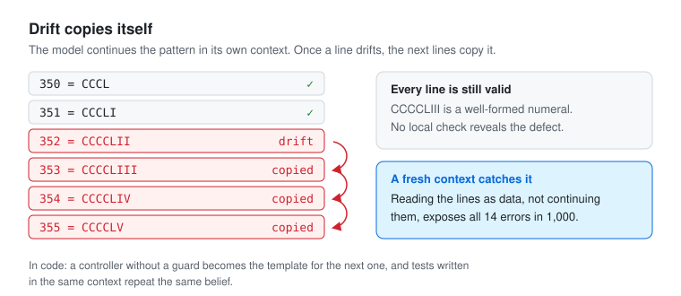
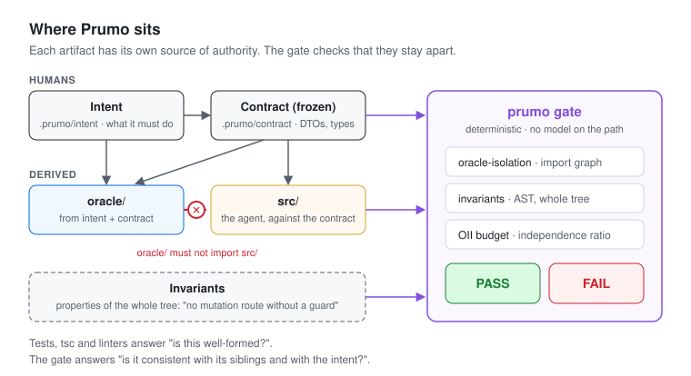
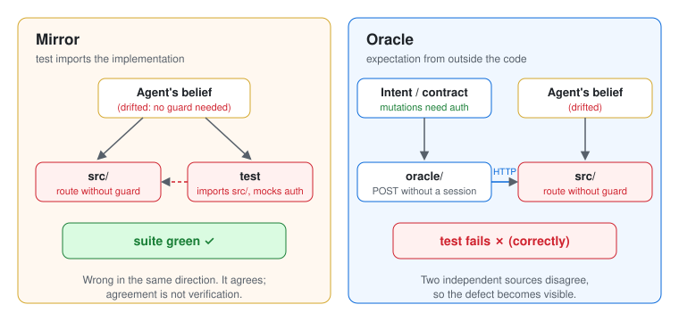
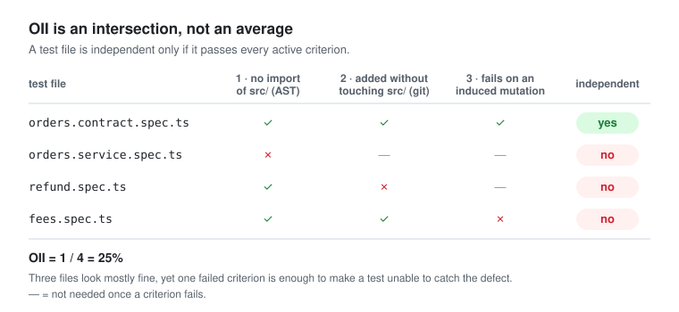

# Concepts

What Prumo does, in plain words first, then the model it enforces and where that model stops.
The first two sections need no programming background.

## Prumo in one minute

*Prumo* is Portuguese for plumb line: a string with a weight that hangs straight down. A mason
holds it next to a wall to see if the wall leans. The wall cannot fool it, because the line does
not come from the wall.

Software teams now let AI agents write code, and often the same agent also writes the tests
that check that code. That is like letting the bricklayer judge the wall by looking only at the
wall. If the agent misunderstood something, the code and its tests carry the same mistake, every
test passes, and nobody notices.

Prumo is the plumb line for that situation. It is a check that runs automatically before code is
accepted, and it answers three questions:

1. **Are the tests measuring against a real reference?** A test should take its expected answer
   from what people wrote down the system must do, not from the code it is testing.
2. **Does the code follow the project's rules as a whole?** For example: "every action that
   changes data requires a login". A single test cannot see this; Prumo scans the whole project.
3. **Are the agreed boundaries still the ones people approved?** Once a person approves a
   boundary (the shape of the data the system accepts and returns), Prumo flags any change made
   without a new approval.

The result is a plain pass or fail. Prumo uses no AI to decide it, so the same project always
gets the same answer.

| In the picture | In a software project |
|---|---|
| the plumb line | what people wrote the system must do (intent) and the approved boundaries (contract) |
| the wall | the code the agent writes |
| the wall leaning | a bug |
| the mason's measurements | the tests |
| measuring with the plumb line | an **oracle**: a test that can catch the bug |
| judging the wall by the wall | a **mirror**: a test that always agrees with the code |

The project's headline number, the **OII**, is not how far the wall leans. It is how much of the
wall was checked with the plumb line: the share of tests that are oracles.

## Words used in this document

| Word | Meaning |
|---|---|
| agent | an AI tool that writes code |
| test | a small program that checks the code gives the expected answer |
| intent | plain-language rules, written by people, of what the system must do |
| contract | the approved shape of the data at the system's boundaries, frozen after a person approves it |
| oracle | a test whose expected answer comes from the intent or the contract, so it fails when the code is wrong |
| mirror | a test that takes its expected answer from the code itself, so it agrees even when the code is wrong |
| invariant | a rule about the whole project, such as "no data-changing route without a login" |
| gate | the automatic pass/fail check that runs before code is accepted |
| OII | Oracle Independence Index: oracles divided by all tests |
| waiver | a written, expiring exception to a rule, with the name of who approved it |

## The problem: tests that agree with the code

Ask a model to write a list of 1,000 lines like `three hundred fifty-three = CCCLIII` and it
gets a few wrong, always in the same place. In one experiment, 14 of 1,000 lines were wrong,
all in the `x52`–`x59` run of two decades (`CCCCLIII` instead of `CCCLIII`). The model was not
computing numerals; it was continuing the pattern in its own context. Once one line drifted,
the next lines copied the drift, because the previous line was the strongest evidence in the
window. Every wrong line was still a *valid* numeral. Nothing local revealed the defect; only
the set did. A fresh-context audit caught all 14, not because it was smarter, but because it
read the lines as data instead of continuing them.



Software has the same failure mode, with higher stakes:

- **The drift gets committed.** A controller missing a guard becomes the template for the next
  one the agent writes.
- **The test defends the drift.** A test written in the same context as the code encodes the
  same belief. If the belief is wrong, code and test are wrong in the same direction, and the
  suite stays green.
- **Standard tooling checks validity, not consistency.** `tsc`, linters and test runners answer
  "is this well-formed?", never "is this consistent with its siblings and with the intent?".

Prumo adds a mechanical layer that checks the second question.



## Mirrors and oracles

A **mirror** is a test that imports the implementation (`src/**`). It inherits the
implementation's assumptions and cannot fail when they are wrong. It agrees, and agreement is
not verification.

An **oracle** is a test whose expectation comes from somewhere the implementation did not:
intent, a frozen contract, real infrastructure. It can fail when the code is wrong.



The rule the gate enforces:

> **`oracle/**` must not import `src/**`.** (`oracle-isolation`, severity `error`)

The check reads the import graph (AST), resolving relative paths and tsconfig `paths`/`baseUrl`
aliases. A dynamic `import(x)` whose specifier is not a literal cannot be resolved statically and
is reported as a warning.

## Three artifacts, three sources of authority

| Artifact | Directory | Written by | Executable | Role |
|---|---|---|---|---|
| Intent | `.prumo/intent/` | humans | no | what the system must do |
| Contract | `.prumo/contract/` | humans, frozen | types only | boundaries: DTOs, interfaces, schemas |
| Oracle | `oracle/` | derived from intent | yes | verification; never reads `src/` |
| Invariant | `.prumo/invariants/` | derived from intent | yes, whole-tree | properties of the set, not of a unit |
| Implementation | `src/` | agent | yes | imports contract, never oracle |
| Waiver | `.prumo/waivers/` | humans | no | explicit, expiring debt |

Intent is non-executable on purpose: an executable spec is another implementation.
The contract is where authority returns to a human: the agent that needs a DTO must ask for it,
not invent it. `contract-frozen` warns when a contract changes in the same commit as `src/`.

Invariants are the artifact TDD has no equivalent for. "No mutation route without a guard" or
"no two controllers in a feature are near-duplicates" are properties of the whole tree. No unit
test can assert them.

## Oracle Independence Index (OII)

`OII = independent test files / total test files`, where a file is **independent** only if it
passes every active criterion (intersection, not average):

| # | Criterion | Source | Active in |
|---|---|---|---|
| 1 | Does not import `src/**` | AST | all profiles |
| 2 | The commit that added it did not touch `src/**` | git | `standard`, `strict` (when git exists) |
| 3 | Fails on at least one induced mutation in the PR delta | mutation engine | `strict`, or `mutation.enabled` |

Profiles (`oii.profile` in config):

| Profile | Criteria | Typical use |
|---|---|---|
| `fast` | 1 | adopting on an existing codebase (`--preset starter`) |
| `standard` | 1 + 2 | default |
| `strict` | 1 + 2 + 3 | release discipline (`--preset strict`) |



How to read it: OII near 0 means a green suite with no independent evidence. OII near 1 means
tests derived independently of the code.

In the plumb-line picture ([Prumo in one minute](#prumo-in-one-minute)): OII is how much of the
wall was checked with the plumb line, not how far the wall leans.

The `budget` check turns the number into a consequence. It fails when:

- `oiiScore < budget.minOii`: most tests are mirrors, or
- the test count grew and OII did not grow by at least `budget.minOiiDelta`: new tests added
  cost without adding independence.

The second rule changes behavior. Without it, the path of least resistance for an agent is to
generate more mirror tests.

### Criterion 2 is a signal, not a boundary

Git provenance is a process heuristic. It anchors on the *content* of the test file: it finds
the blob the latest commit added and the oldest commit that added that same blob (`--no-renames`).
It is environmental (a shallow clone or a missing `.git` changes the number) and it can still be
gamed by re-adding identical content in a separate commit. Treat it as visibility into commit hygiene, never as
proof. Run CI with `fetch-depth: 0`, and prefer criterion 3 when you need evidence that a test
can actually fail.

## The test pyramid inverts

An oracle is strong in proportion to how much of it lives outside the agent's context.

```
   ▲  few unit tests with mocks        (mirrors: cut)
  ▲▲  contract tests / schema diffs    (external oracle)
 ▲▲▲  integration against real infra   (the agent does not control the database)
▲▲▲▲  global static invariants         (scan the whole tree)
```

A mock like `{ provide: PaymentsClient, useValue: mock }` is the agent's belief about the
contract. If the belief drifted, mock and code drift together. A real Postgres enforces
`NOT NULL`, `UNIQUE` and foreign keys the agent did not write. In AI-assisted work, reduce
agent-written mocked unit tests; the budget charges for them.

Honest limit: integration tests are independent in the *infrastructure*, not in the *scenario*.
The agent still picks the scenario.

## Skills are defined by what they cannot read

A Prumo skill is a contract about context, not a prompt template. Its essential field is
`forbiddenReads`:

| Skill | Reads | Must not read | Why |
|---|---|---|---|
| `contract-author` | intent | `src/**`, `oracle/**` | if it reads the code, the code defines the contract |
| `oracle-author` | intent, contract | `src/**` | a test written by someone who read the code is a mirror |
| `reference-implementer` | intent, contract, oracle | — | the human-reviewed anchor for a family |
| `instantiator` | contract, oracle, the reference | the other siblings | reading a sibling copies its drift |
| `invariant-auditor` | everything | the context that generated the code | fresh context is the cure |
| `gate-runner` | — | — | no model at all |

The gate enforces oracle isolation. Read barriers are declared; enforcing them in an IDE needs a
harness. See [harness.md](harness.md).

## Usage modes

| Mode | When | Minimum |
|---|---|---|
| **Guardrail** | mature codebase, small PRs | config + framework plugin; `prumo gate` in CI |
| **Brownfield** | legacy, no `.prumo/` yet | `prumo setup`, baseline gate, `prumo interview` to extract intent, then invariants |
| **Greenfield** | new feature or repo | intent → contract → oracle → src, in separate commits |
| **Governance** | regulated or air-gapped teams | strict budget, waivers with expiry and approver, `--fail-on-warn`, mutation on release branches |

The layers stay separate: `prumo gate` judges; `prumo status` only suggests the next step and
never changes a verdict.

## How Prumo relates to other tools

| Tool | Overlap | Use together |
|---|---|---|
| Jest, Vitest, pytest | none: Prumo does not run your tests | run `prumo gate`, then your test command |
| Stryker | Prumo has a delta mutation engine for criterion 3 | Stryker for full-repo audits |
| Semgrep, ESLint, ArchUnit | static rules | generic rules there; oracle model and framework invariants here |
| Spec/planning kits | intent files | intent in `.prumo/intent/`, verified by the gate |
| AI test generators | they often produce mirrors | generate, then enforce isolation |

## Limits

- Prumo does not write intent, contracts or oracles. Semantic authority stays human.
- Route scans catch **omission**, not wrong presence: a guard wired to the wrong route passes.
- Dynamic registration (factories, spreads, loops in `@Module`) is invisible to the AST and can
  produce false positives; use a narrow, expiring waiver.
- Name-based rules (`monetary-is-integer`) are heuristics, which is why they are `warn`.
- A low mutation score suggests decorative tests; it does not prove them.
- This does not turn one prompt into a large system. It moves human work to intent, references
  and gates: deriving is human, completing is the agent's.
